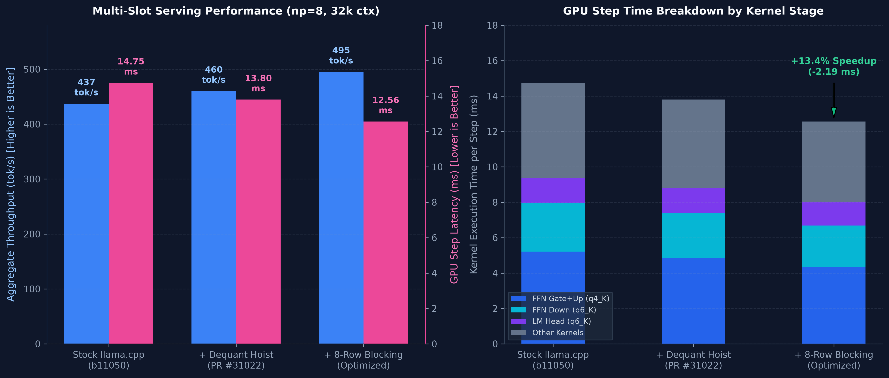

# llama.cpp Vulkan matvec: dequant hoisting + 8-row blocking

A patch to llama.cpp's Vulkan `mul_mat_vecq` shader that recovers most of the
multi-slot throughput lost to redundant K-quant dequantization and activation
reads.

Measured on one AMD RX 9070 XT (RDNA4, gfx1201) serving
DeepSeek-R1-Distill-Qwen-7B Q4_K_M to eight concurrent slots at 32k context
with an f16 KV cache:

| np=8 | aggregate tok/s | GPU time per step |
|---|---:|---:|
| stock llama.cpp b11050 | 437.0 | 14.75 ms |
| + dequant hoist | 460 | 13.80 ms |
| + 8-row blocking | **495** | **12.56 ms** |

**+13.4% aggregate over stock.** Single-stream throughput is unchanged
(117.4 vs 117.6 tok/s), and eight concurrent greedy requests produce
byte-identical output before and after.

Upstream PR (Phase 1 dequant hoist): [ggml-org/llama.cpp#31022](https://github.com/ggml-org/llama.cpp/pull/31022)



## The problem

At batch 1, decode is a weight-bandwidth problem: every step reads every
weight once, and the stock Vulkan kernels already run within about 11% of this
card's measured streaming ceiling. A HIP replay of the exact Q4_K access
pattern reaches 634.9 GB/s against 635.7 GB/s for plain streaming, so the
access pattern itself is not the constraint.

At np=8 the shape changes, and two redundancies appear in `mul_mat_vecq`:

1. **Weight dequantization sat inside the token-column loop.** For each output
   row, every one of the eight token columns re-read and re-unpacked the same
   K-quant block. Same bytes, same integer work, eight times.
2. **Activation reads repeated per output row.** A workgroup owned four output
   rows and re-read the whole activation slice for them. Widening the block to
   eight halves the activation bytes per output row.

The first is the simpler win. The second is what pushes the aggregate past
460, and it also exposes the next limit: the LM head is activation-bound and
needs shared-memory staging rather than a wider row block.

## What the patch changes

Three files, +192/−104 lines, against llama.cpp b11050 (`60b06ab`).

- **`mul_mat_vecq_funcs.glsl`** — split each quant type's
  `mmvq_dot_product()` into `load_a_tile()` (unpack a weight block into
  registers) and `dot_a_tile()` (dot it against the cached activation). The
  `a_tile` struct carries the unpacked `qs` words and the scale/dm values.
- **`mul_mat_vecq.comp`** — `iter()` preloads one `a_tile` per output row
  before the column loop and reuses it for every column. `compute_outputs()`
  skips the 4× k-unroll when `NUM_ROWS >= 8`: at eight rows the 8×8 inlined
  bodies already saturate the scheduler and the extra unroll spills
  (gate/up ran at 165 µs instead of 97 µs with it).
- **`ggml-vulkan.cpp`** — `rm_int_n_wide()` selects eight rows for Q4_K and
  Q5_K in the 4–8-column variants. The guard reuses the existing
  RDNA3-class check; llama.cpp's architecture detector classifies gfx1201 as
  `AMD_RDNA3` because it keys off the integer-dot extension, so the 9070 XT
  takes the wide path while other GPUs keep their previous tuning.

Q6_K keeps its existing row block; it gets the hoist but not the wider block.
i-quants use separate shaders and are untouched.

## Results

### End to end

Measured with direct `/completion` requests, 256 output tokens per slot, three
runs, medians, at 32k context with an f16 KV cache. Per-op timings come from
`GGML_VK_PERF_LOGGER=1`.

| np=8 | stock | + hoist | + 8-row | Δ vs stock |
|---|---:|---:|---:|---:|
| aggregate tok/s | 437.0 | 460 | **495** | **+13.4%** |
| GPU time per step | 14.75 ms | 13.80 ms | **12.56 ms** | **−14.8%** |

### Per op

| op | stock | + hoist | + 8-row | note |
|---|---:|---:|---:|---|
| q4_K gate+up, m=18944 | 108.5 µs | 97.0 µs | **77.8 µs** | activation-bound; biggest win |
| q4_K K/V, m=512 | 15.0 µs | 14.1 µs | **10.1 µs** | activation-bound |
| q6_K FFN down, m=3584 | 191.4 µs | 175.0 µs | **166.5 µs** | hoist only |
| q4_K attention q/o, m=3584 | 25.6 µs | 24.1 µs | 24.3 µs | neutral |
| q4_K FFN down, m=3584 | 74.8 µs | 75.0 µs | 80.5 µs | weight-bound; +7.3% |
| q6_K LM head, m=152064 | 1320.9 µs | 1352.4 µs | 1348.0 µs | activation-bound; unchanged |

The wider block wins where activation traffic is the limiter and is
neutral-to-slightly-negative where the weight stream dominates. Gate/up is
about 35% of the step, which is why the aggregate still improves despite the
q4_K FFN-down regression.

## Correctness

- Eight concurrent greedy requests (`temperature: 0`, `seed: 7`, 256 tokens)
  produced byte-identical output before and after. The two outputs are in
  [`results/correctness/`](results/correctness/).
- The patch changes which workgroup owns which output rows and when a weight
  tile is unpacked, not the per-element arithmetic order.
- PPL on wikitext-2 (ctx 512, 24 chunks) is 23.6013 on the patched build,
  matching the 23.60 recorded for the stock Q4_K_M stack.

## Reproduce

```bash
# Build a fresh llama.cpp at the tested commit, apply the patch, build Vulkan.
./reproduce.sh

# Serve the 7B with eight slots.
build/bin/llama-server \
  -m "$HOME/models/DeepSeek-R1-Distill-Qwen-7B-Q4_K_M.gguf" \
  --alias deepseek-r1-7b --host 127.0.0.1 --port 8082 \
  -c 32768 --parallel 8 -ngl 99 -fa on \
  -ctk f16 -ctv f16 --cache-reuse 256 --reasoning off

# Measure aggregate throughput and draft acceptance (draft off here).
CONCURRENT=8 RUNS=3 MAX_TOKENS=256 CTX=32768 PARALLEL=8 \
KVTYPE_K=f16 KVTYPE_V=f16 \
  ./bench/spec-decode.sh np8
```

The HIP microbenches in [`bench/gpu/`](bench/gpu/) establish the bandwidth
ceiling and replay the Q4_K access pattern:

```bash
hipcc -O3 --offload-arch=gfx1201 bench/gpu/bwtest.cpp -o bwtest
hipcc -O3 --offload-arch=gfx1201 bench/gpu/q4k_pattern.cpp -o q4k_pattern
./bwtest 1024 5
./q4k_pattern 4608
```

## Scope and caveats

- **One GPU, one stack, one model.** RX 9070 XT, RADV/Vulkan, 7B Q4_K_M,
  np=8. Treat the percentage as a case study, not a universal constant.
- **Throughput, not latency.** Single stream takes the `NUM_ROWS < 8` path and
  is unchanged by design. Speculative decoding was measured separately on this
  card and lost; this patch is for concurrent serving.
- **Not upstreamed.** It is a patch against b11050 (`60b06ab`), not a fork.
  llama.cpp moves quickly, so a newer build will need a rebase.
- **Architecture guard.** The wide-row path reuses the `AMD_RDNA3`
  classification, which includes gfx1201 on this build. Verify the mapping
  before porting to another architecture.
- **The next limit is activation traffic.** The LM head re-reads about 1.09 GB
  of activations per step; sharing one activation slice across columns in
  shared memory measured up to 24% faster on that op alone.

## Repo layout

```
patches/        the diff against llama.cpp b11050
bench/          end-to-end and per-op harnesses, plus the HIP microbenches
docs/           the full performance analysis and methodology
results/        raw per-op tables, PPL, and the correctness outputs
reproduce.sh    clone, patch, and build
```

The longer write-up, including what did not work (IQ4_XS, speculative
decoding, activation staging), is in
[`docs/perf-analysis.md`](docs/perf-analysis.md).

## License

MIT. The patch modifies llama.cpp, which is MIT-licensed.
